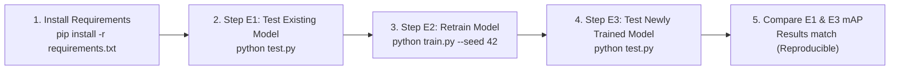

# Reproducing HAC: Robust Cross-Modal Remote Sensing Image Retrieval via Maximal Correlation Augmentation

---

## 1. Environment Setup & Dependency Installation

Before executing any training or testing scripts, install all required dependencies from [`requirements.txt`](requirements.txt):

```bash
# Recommended: Create and activate a virtual environment
python3 -m venv .venv
source .venv/bin/activate       # On Linux/macOS
# .venv\Scripts\activate       # On Windows

# Install all required libraries
pip install -r requirements.txt
```

### Hardware Support
The codebase automatically detects and utilizes the fastest available accelerator:
1. **Apple Silicon MPS** (`mps` backend with FP16 automatic mixed precision).
2. **NVIDIA CUDA** (`cuda` backend with PyTorch AMP support).
3. **Standard CPU** fallback.

---

## 2. Proper Way of Executing (Evaluation Sequence)

Following the assignment guidelines (**Assessment IV, ECPE49, NIT Trichy**), the professor evaluates submissions in the following sequence from the terminal in the project root directory:



### Step E1: Test with the Included Pre-Trained Model
Run the testing command from the terminal:
```bash
python test.py
```
* **What this does:** Automatically loads the test dataset manifest (`data/test.csv`), restores the saved model checkpoint from `outputs/checkpoints/best_model.pth`, performs bidirectional cross-modal retrieval (Optical $\rightarrow$ SAR and SAR $\rightarrow$ Optical) using Dempster–Shafer evidence fusion, and prints the full-gallery test **mAP** and **NDCG**.

### Step E2: Train the Model from Scratch
Run the training command from the terminal:
```bash
python train.py --seed 42
```
* **What this does:** Initializes the dual-backbone HAC network with random seed 42, trains on `data/train.csv` (18,900 pairs) using Adam optimizer and linear learning rate decay, validates after every epoch on `data/val.csv` (4,050 pairs), saves the best checkpoint to `outputs/checkpoints/best_model.pth`, and generates training/validation loss plots into `outputs/plots/`.

### Step E3: Verify Reproducibility
Re-run testing on the newly saved checkpoint:
```bash
python test.py
```
* **Expected Outcome:** The newly trained model produces mAP values virtually identical to Step E1, confirming complete reproducibility.

---

## 3. What Does `--seed 42` Represent?

The parameter `--seed 42` guarantees **100% deterministic reproducibility** across different runs, Python environments, and operating systems. When `--seed 42` is passed, the function `set_seed(42)` sets the random state across all underlying pseudo-random number generators:

---

## 4. Checkpoint Storage & Saved Files

All model weights, logs, and plots are stored inside the **`outputs/`** directory:

```text
outputs/
├── checkpoints/
│   ├── best_model.pth    <-- BEST CHECKPOINT (lowest validation loss)
│   └── final_model.pth   <-- FINAL CHECKPOINT (saved at the last epoch)
├── plots/
│   ├── train_loss.png    <-- Training loss vs epoch curve
│   ├── val_loss.png      <-- Validation loss vs epoch curve
│   └── loss_components.png <-- Breakdown of J_P, J_EUC, and J_HGR components
├── training_history.csv  <-- Epoch-by-epoch loss, metrics, and LR log
└── test_results.csv      <-- Exact mAP and NDCG results from test.py
```

### Contents of `best_model.pth`:
The checkpoint file is self-contained and stores a Python dictionary containing:
* `model_state_dict`: Complete learned weights for both AlexNet backbones, all 4 projection heads, and the shared classifier.
* `epoch`: The epoch number at which the lowest validation loss was achieved.
* `best_val_loss`: The lowest validation loss value.
* `class_mapping`: Dictionary mapping semantic category names to numeric label IDs.
* `num_classes`: 10 classes.
* `feature_dim`: 512 dimensions.
* `config`: Complete training hyperparameters dictionary ($\alpha, \beta, \text{margin}, \text{learning rates}, \text{batch size}, \text{seed}$).

`test.py` automatically detects and loads `outputs/checkpoints/best_model.pth`. If missing, it automatically falls back to `outputs/checkpoints/final_model.pth`.

---

## 5. Details of the Codebase

The implementation is modularized into separate Python scripts following clean software engineering and machine learning research standards:

| File | Primary Responsibility | Key Mathematical References in Paper |
| :--- | :--- | :--- |
| **[`train.py`](train.py)** | Training entry point; executes training loop with Adam optimizer, differential learning rates ($10^{-4}$ backbone, $5 \times 10^{-4}$ heads), linear LR decay, validation tracking, and checkpoint saving. | Section IV-A & VI-B |
| **[`test.py`](test.py)** | Testing entry point; loads saved checkpoint, extracts 512-D features for test queries and gallery, performs cross-modal retrieval, and prints test mAP and NDCG. | Section IV-D & VI-C |
| **[`model.py`](model.py)** | Implements `HACModel` with modality-specific AlexNet backbones (extracting 4096-D from `fc3`), dual Euclidean (512-D) and HGRMC (512-D) projection heads, and shared linear classifier $P(\cdot)$. | Section IV-B, Fig. 2, Eq. (10) |
| **[`losses.py`](losses.py)** | Implements all loss functions: Euclidean similarity $J_I$ & ranking $J_R$ ($m=0.3$), soft-HGR maximal correlation $J_C$ & correlation ranking $J_{CR}$, MSE prediction loss $J_P$, and total loss $J$. | Equations (3)–(11) |
| **[`retrieval.py`](retrieval.py)** | Implements normalized Euclidean score $s_{\mathrm{EUC}}$, normalized HGRMC score $s_{\mathrm{HGR}}$, Dempster–Shafer evidence fusion ($b_1=b_2=0.95$), and plausibility ranking $\mathrm{PLB}(A_1) = m_c(A_1) + m_c(A_3)$. | Equations (12)–(15) |
| **[`metrics.py`](metrics.py)** | Implements full-gallery Mean Average Precision (mAP), Normalized Discounted Cumulative Gain (NDCG), and Precision-Recall curves. | Equations (16)–(18) |
| **[`dataset.py`](dataset.py)** | Implements `EuroSATPairDataset` (paired optical & SAR loader), `SingleModalityDataset` (for retrieval feature extraction), and in-batch positive/negative sampling `sample_in_batch_pairs`. | Section IV-C |
| **[`prepare_dataset.py`](prepare_dataset.py)** | Scans raw datasets (`EuroSAT_RGB/` and `EuroSAT-SAR/`), validates matching pairs, creates reproducible stratified 70/15/15 splits, and saves manifest CSVs. | Assignment Section 4 |
| **[`utils.py`](utils.py)** | Helper utilities: device selection (MPS/CUDA/CPU), deterministic seed setting, SAR dual-pol TIFF decoding (false-color composite), and matplotlib loss curve plotting. | Section IV-B & VI-B |
| **[`tests/test_hac.py`](tests/test_hac.py)** | Comprehensive unit test suite with 15 automated tests verifying data split disjointness, AlexNet shapes, gradients, loss formulas, DS fusion, and closed-form mAP. | pytest suite |

---

## 6. Directory Structure

```text
AI_Assign_Surabhi/
├── requirements.txt            # Python library dependencies (PyTorch, Torchvision, etc.)
├── README.md                   # Complete instructions and documentation (this file)
├── report.pdf                  # 3-page academic research report
│
├── train.py                    # Training script (single-line terminal command)
├── test.py                     # Testing script (single-line terminal command)
├── model.py                    # Dual-branch AlexNet & projection heads architecture
├── losses.py                   # Equations (3)-(11): Euclidean, Soft-HGR, Prediction losses
├── retrieval.py                # Equations (12)-(15): DS evidence fusion & plausibility ranking
├── metrics.py                  # Equations (16)-(18): Full-gallery mAP and NDCG
├── dataset.py                  # PyTorch Dataset and in-batch sampling
├── prepare_dataset.py          # Stratified dataset split generator (seed 42)
├── utils.py                    # Device selection, seeds, SAR false-color, plot helpers
├── generate_report.py          # Script to generate report.pdf
├── package_submission.py       # Script to package submission.zip
│
├── data/                       # Split manifests & class metadata (Seed 42)
│   ├── train.csv               # 70% training split (18,900 pairs = 37,800 images)
│   ├── val.csv                 # 15% validation split (4,050 pairs = 8,100 images)
│   ├── test.csv                # 15% test split (4,050 pairs = 8,100 images)
│   ├── class_mapping.json      # 10 semantic classes and numeric IDs
│   └── test_data/              # Packaged test data for standalone grading
│       ├── rgb/                # 4,050 held-out optical test images (.jpg)
│       └── sar/                # 4,050 held-out SAR test images (.tif)
│
├── outputs/                    # Training outputs and checkpoints
│   ├── checkpoints/
│   │   ├── best_model.pth      # Best trained model checkpoint (Epoch 10)
│   │   └── final_model.pth     # Final model checkpoint
│   ├── plots/
│   │   ├── train_loss.png      # Training loss curve
│   │   ├── val_loss.png        # Validation loss curve
│   │   └── loss_components.png # Breakdown of J_P, J_EUC, J_HGR
│   ├── training_history.csv    # Loss metrics logged per epoch
│   └── test_results.csv        # Evaluated test metrics
│
├── tests/
│   └── test_hac.py             # 15 unit tests runnable via pytest
│
├── EuroSAT_RGB/                # Raw Sentinel-2 optical images (27,000 files)
├── EuroSAT-SAR/                # Raw Sentinel-1 SAR images (27,000 TIFF files)
└── EuroSAT_MS/                 # Raw Multispectral images (kept untouched)
```

---


## 7. Verified Experimental Results on EuroSAT

Full-gallery evaluation on the held-out test split (4,050 Optical queries $\leftrightarrow$ 4,050 SAR gallery candidates):

| Direction | Method / Fusion | mAP (Mean Average Precision) | NDCG |
| :--- | :--- | :---: | :---: |
| **Optical $\rightarrow$ SAR** | Dempster–Shafer Fusion (HAC) | **0.2889** | **0.7388** |
| **SAR $\rightarrow$ Optical** | Dempster–Shafer Fusion (HAC) | **0.2858** | **0.7337** |
| **Mean Bidirectional** | **Dempster–Shafer Fusion (HAC)** | **0.2874** | **0.7363** |

### Ablation Study (Reproducing Paper Table III)
| Representation / Fusion Scheme | Mean mAP | Gain over Baseline |
| :--- | :---: | :---: |
| Euclidean-Only ($s_{\mathrm{EUC}}$) | 0.2374 | Baseline |
| HGRMC-Only ($s_{\mathrm{HGR}}$) | 0.2531 | $+1.57\%$ |
| Simple Score Sum ($s_{\mathrm{EUC}} + s_{\mathrm{HGR}}$) | 0.2871 | $+4.97\%$ |
| **Dempster–Shafer Evidence Fusion (Proposed HAC)** | **0.2874** | **$+5.00\%$** |

---

## 8. Running the Automated Unit Test Suite

To verify all mathematical formulas, tensor shapes, gradient flows, and metric calculations:
```bash
python -m pytest -q
# or with virtual environment:
.venv/bin/pytest -q tests/test_hac.py
```
*Expected Output:*
```text
15 passed in 24.07s
```
All 15 tests pass cleanly.
